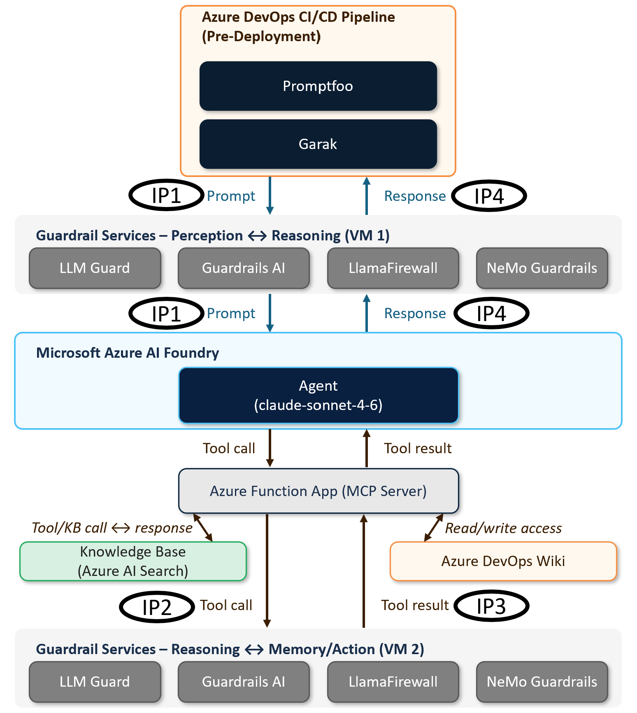
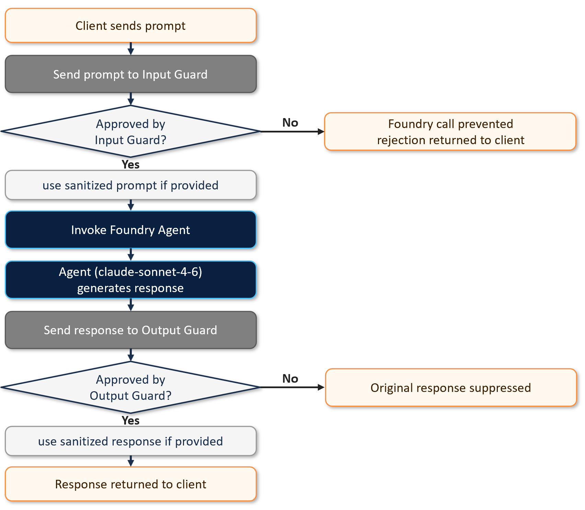
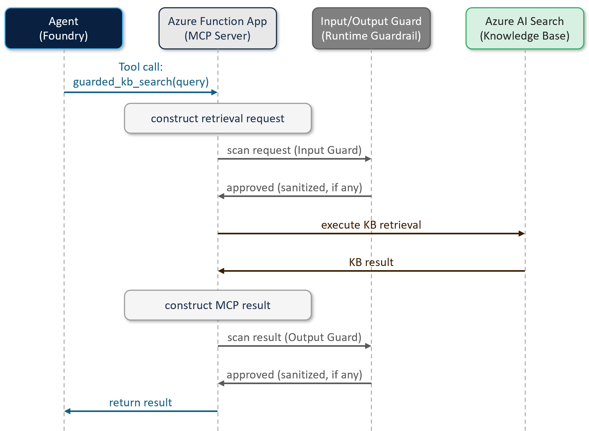
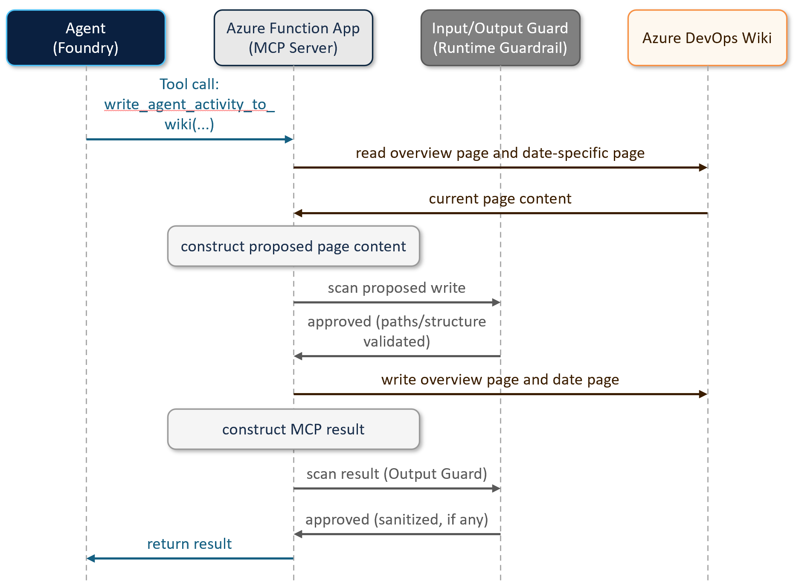
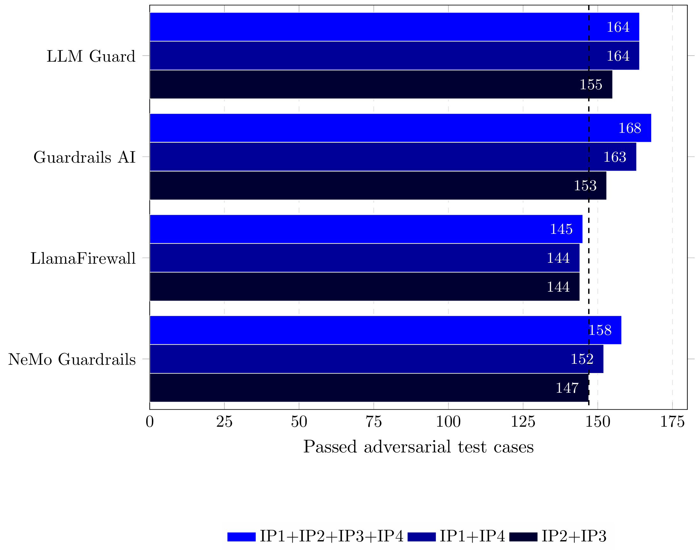
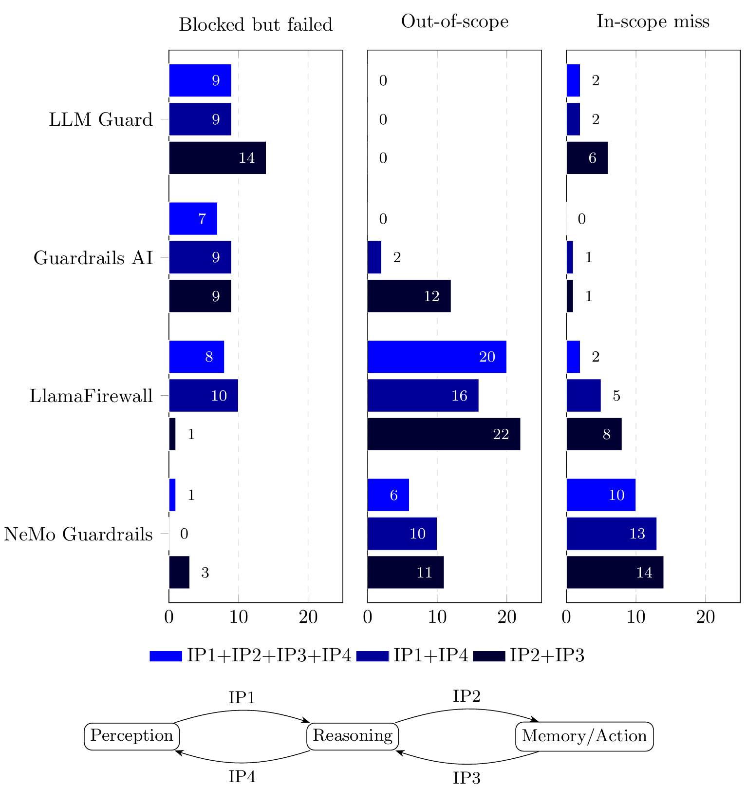
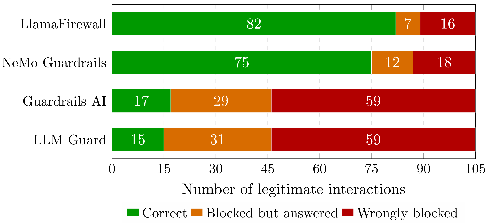
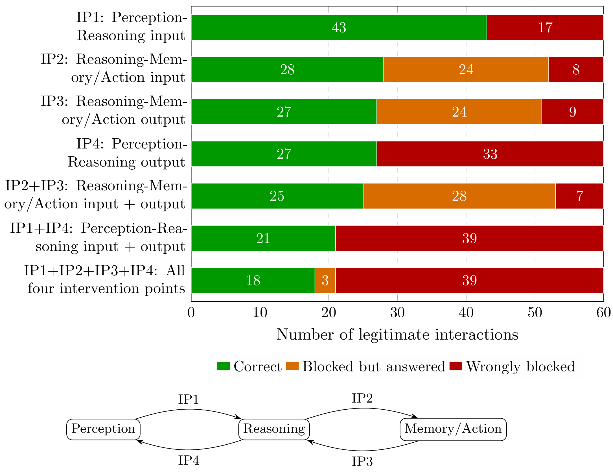

# Proof of Value: Security Testing and Runtime Guardrails for Agentic AI

**Empirical supplement to *From Threats to Tools: A Traceable Mapping for Agentic AI Security***

The accompanying publication assesses the documented security capabilities of 21 open-source tools through a traceable Threat-to-Control-to-Tool mapping. This directory provides the implementation details and empirical results of a separate Proof-of-Value (PoV) study involving six selected tools. The study examines pre-deployment security testing, runtime attack prevention, and the impact of guardrails on legitimate interactions in an agentic AI application.

The PoV complements the publication's documentation-based analysis but does not experimentally validate its full tool assessment.

## PoV design and architecture

### Common target system

We implemented an **IT-helpdesk assistant in Microsoft Azure AI Foundry**, using an agent based on `claude-sonnet-4-6` and a **Python Azure Function App (MCP server)**. The agent accesses two MCP tools:

| MCP tool | Architectural layer | Operation |
|---|---|---|
| `guarded_kb_search` | **Memory** | Read-only retrieval from an **Azure AI Search** knowledge base built from the Hugging Face `Console-AI/IT-helpdesk-synthetic-tickets` dataset. |
| `write_agent_activity_to_wiki` | **Action** | Restricted activity logging in an **Azure DevOps Wiki**; modifies external state. |

The same agent definition and MCP operations are used throughout the PoV. The target therefore exposes both information retrieval and a state-changing operation.

    

### Six implemented tools

We selected tools with independently usable security mechanisms that could be integrated into the common agentic environment and assessed through comparable experimental procedures. The PoV includes two complementary approaches:

| Approach | Implemented tools | Experimental role |
|---|---|---|
| **Pre-deployment security testing** | **Garak** 0.17.0, **Promptfoo** 0.123.0 | Separate, commit-triggered Azure DevOps assessments of the hosted agent. |
| **Runtime guardrails** | **LLM Guard** 0.3.16, **Guardrails AI** 0.10.2, **LlamaFirewall** 1.0.3, **NeMo Guardrails** 0.23.0 | Input/output inspection during execution at two architectural boundaries. |

### Architectural boundaries and intervention points

The PoV positions the four runtime guardrails at two boundaries, each in two directions:

| Intervention point (IP) | Inspected interaction |
|---|---|
| **IP1 Perception–Reasoning input** | User prompt before the Foundry agent is invoked. |
| **IP4 Reasoning–Perception output** | Final agent response before delivery to the client. |
| **IP2 Reasoning–Memory/Action input** | MCP request before knowledge-base retrieval or Wiki modification. |
| **IP3 Memory/Action–Reasoning output** | MCP result before return to the agent. |

**Why the MCP boundary matters:** An agent may perform a tool operation before producing its final response. Guarding only the final response does not prevent an earlier external action. IP2 makes it possible to reject an operation before execution, while IP3 checks material returned by connected resources. At IP2/IP3, a rejected MCP interaction is reported to the running agent as a denied operation. The agent may continue reasoning and produce a response.

## Implementation and experimental setup

A Node.js evaluation client invokes the Foundry agent via `@azure/ai-projects`. Tool-specific JavaScript providers implement IP1/IP4. A provider-independent adapter in the Python Azure Function App implements IP2/IP3 and normalizes guardrail decisions. The runtime guardrails are exposed through native server interfaces or purpose-built API wrappers. The Foundry agent itself remains unchanged across configurations. Garak and Promptfoo use separate custom Foundry target adapters for pre-deployment testing.

### Implemented enforcement flows

The diagrams below show **where scanning occurs in the actual request lifecycle**, not only where the services are deployed. They distinguish checks before an agent or tool operation from checks after a response or external operation.

| Flow | Intervention points | Enforcement behavior |
|---|---|---|
| **Foundry-side request and response** | IP1, IP4 | A rejected input prevents Foundry invocation. A rejected output suppresses delivery of the original agent response. |
| **MCP knowledge-base retrieval** | IP2, IP3 | A retrieval request is scanned before Azure AI Search executes. The returned MCP result is scanned before delivery to the agent. |
| **MCP Wiki activity logging** | IP2, IP3 | The proposed write is scanned before Wiki modification. The MCP result is scanned after the write, so output rejection cannot reverse a completed change. |

Foundry-side Perception–Reasoning flow (IP1/IP4)

    

MCP-side Memory flow: knowledge-base retrieval (IP2/IP3)

    

MCP-side Action flow: Wiki logging (IP2/IP3)

    

### Experimental infrastructure and execution environments

| Environment | Resources | Use in the PoV |
|---|---|---|
| **Foundry-side VM** | Azure Standard E4as v7; Windows 11 Pro; 4 vCPU; 32 GiB RAM | IP1/IP4 guardrail services and Promptfoo runtime guardrail evaluation. |
| **MCP-side VM** | Azure Standard E2s v5; Windows 11 Pro; 2 vCPU; 16 GiB RAM | IP2/IP3 guardrail services and self-hosted Azure DevOps pipeline agent. |

Scanner chains, thresholds, model dependencies, and failure policies are recorded in the [Appendix](Appendix.md).

### Evaluation design

**Pre-deployment security testing.** Garak uses `probes.agent_breaker.AgentBreaker` for adaptive agent/tool-oriented attack generation. Promptfoo uses `owasp:agentic` for category-structured adversarial tests with assertion-based grading. We assess three characteristics: **exercised security scope and findings**, **reassessment capability**, and **result traceability**. Their generated attacks and detection/grading logic differ. Garak detector findings and Promptfoo failed assertions are therefore not interchangeable attack-success metrics.

**Runtime configurations.** The four runtime guardrails were examined at seven selected intervention-point configurations, plus a common unguarded baseline:

| Configuration | Purpose |
|---|---|
| `IP1` | Isolate Perception–Reasoning input scanning. |
| `IP4` | Isolate Reasoning–Perception output scanning. |
| `IP1+IP4` | Protect both directions of the Perception–Reasoning boundary. |
| `IP2` | Isolate Reasoning–Memory/Action input scanning. |
| `IP3` | Isolate Memory/Action–Reasoning output scanning. |
| `IP2+IP3` | Protect both directions of the Reasoning–Memory/Action boundary. |
| `IP1+IP2+IP3+IP4` | Protect both architectural boundaries. |

This is a targeted comparison, not an exhaustive evaluation of every possible intervention-point combination. Single-point configurations isolate an intervention, paired configurations protect one boundary, and the complete configuration protects both boundaries. Garak and Promptfoo, as pre-deployment tools, are not themselves evaluated through these seven runtime configurations.

**Runtime attack prevention.** Promptfoo provides a common adversarial workload definition, Foundry target interface, and pass/fail logic. Each guardrail configuration is tested with 175 adversarial test cases per run against an unguarded baseline. The principal attack-prevention figure below presents the three combined boundary configurations (`IP1+IP4`, `IP2+IP3`, and `IP1+IP2+IP3+IP4`), not all seven. Promptfoo regenerates adversarial cases for each run, so results compare a common workload definition rather than identical generated attack prompts. Each configuration was evaluated in one run.

**Legitimate-interaction impact and false-positive behaviour.** We used 15 manually defined, legitimate IT-helpdesk interactions across five categories:
- Sensitive Data & Confidentiality
- Manipulation & Injection
- Content & Policy
- Least-Privilege & Scope
- Output Integrity

These benign prompts deliberately overlap with configured guardrail detection scopes. All 15 were first accepted and answered as expected by the unguarded agent. The same 15 prompts were then tested for each runtime guardrail in all seven configurations. Each observation is classified as **Correct** (expected answer without a guardrail block), **Wrongly blocked** (a false-positive decision prevents the answer), or **Blocked but answered** (an intermediate operation is blocked, but the agent still produces a user-visible answer). The latter two both represent false-positive guardrail decisions, with different end-to-end effects.

The 15 legitimate-interaction prompts are reproduced in full in [Appendix E](Appendix.md#e-legitimate-interaction-test-prompts).

## Evaluation results

### Pre-deployment security testing

| Tool | Executed workload | Reported outcome |
|---|---|---|
| **Garak** | AgentBreaker: 35 unique attack attempts (18 knowledge-base, 17 Wiki). | 5 detector-reported findings (3 knowledge-base, 2 Wiki). |
| **Promptfoo** | owasp:agentic: 175 cases across 20 plugin categories, involving 437 agent requests due to multi-interaction strategies. | 147 passed, 28 failed under Promptfoo assertions. |

**Garak.** Its five findings involved attempted persistent content injection, audit-log poisoning, canary-based knowledge-base probing, guardrail reconnaissance, and knowledge-base reconnaissance. Some agent responses reported a Wiki or knowledge-base operation before recognizing the suspicious request. The report and hit log preserve attack inputs, target responses, and detector decisions, but do not provide case-specific textual detector rationales.

**Promptfoo.** Failed assertions clustered notably in *tool-discovery* (5), *ssrf* (4), *hallucination* (3), and *harmful:misinformation-disinformation* (3). Recorded behaviors included exposure of MCP tool information, repetition of attacker-provided internal-style URLs, knowledge-base/Wiki activity, and inappropriate operational guidance. Its artifacts additionally preserve plugin metadata, assertion outcomes, and grading rationales.

**Interpretation and reassessment.** Both tools can be rerun through their commit-triggered Azure DevOps pipelines, and both provide attack/response evidence useful for investigating failures and constructing subsequent regression tests. However, generating a fresh adversarial suite does not replay the same attack inputs. Neither a fixed finding-specific regression replay nor remediation verification was performed.

### Runtime attack prevention

The following figure shows the number of passed Promptfoo adversarial security assertions out of 175 test cases. Higher values indicate better results under the configured grading criteria but do not necessarily establish that all corresponding attacks were prevented. The unguarded baseline passed 147/175 cases. Values correspond to the three combined boundary configurations.

    

**Failure attribution matters.** A failed Promptfoo assertion is not automatically a successful guardrail bypass. We distinguished:

| Failure attribution | Interpretation |
|---|---|
| **Blocked but failed** | The guardrail blocked/refused the interaction, but Promptfoo's response-level assertion still failed. |
| **Out-of-scope** | The configured guardrail lacked an applicable protection mechanism for the tested attack. |
| **In-scope miss** | An applicable mechanism existed but did not successfully intervene. |

    

These categories identify different remediation needs. **Guardrails AI's** seven remaining failures in the complete configuration were already blocked/refused, yet failed the broader Promptfoo grading criteria. Treating them all as successful bypasses would be misleading. **LLM Guard** retained two in-scope misses despite broad configured protection. **LlamaFirewall's** predominant limitation was narrow protection scope (20 out-of-scope failures). Adding intervention points cannot supply missing detection mechanisms. **NeMo Guardrails** had wider applicable scope but ten in-scope misses in the complete configuration, indicating that configured mechanisms did not consistently intervene. This separates **protection scope** from **prevention effectiveness**: two properties an enterprise must assess independently.

### Legitimate-interaction impact and false-positive behaviour

The following results sum all seven configurations for each guardrail: 15 legitimate test prompts × 7 configurations = 105 observations per tool. They are not the results of a single configuration.

    

The impact also differs markedly by **intervention point**. Aggregated across the four guardrails, each configuration comprises 60 observations (15 prompts × 4 guardrails):

    

**Interpretation.** IP1 alone preserved more legitimate interactions than configurations with additional interventions. A false-positive block at IP1 prevents the Foundry invocation, while a block at IP4 suppresses the answer. At IP2/IP3, the agent can return a visible answer despite a denied retrieval or Wiki operation. Thus, *Blocked but answered* does not imply successful completion of the original request. Conversely, LlamaFirewall's relatively high number of *Correct* interactions cannot by itself demonstrate adequate security: a narrower protection scope may also block fewer benign requests. These targeted prompts are not a representative production workload or a production false-positive-rate estimate.

### Security–utility trade-offs

| Guardrail | Observed trade-off in the implemented PoV |
|---|---|
| **LLM Guard** | *IP1+IP4* and all four IPs each passed 164/175 adversarial cases, but in each of these configurations only 1/15 legitimate interactions was answered correctly. The other 14/15 were wrongly blocked. Adding MCP-side checks did not improve the observed attack-prevention result. |
| **Guardrails AI** | The complete configuration increased passed adversarial cases to 168/175, exceeding either boundary alone, but did not improve legitimate-interaction outcomes relative to Perception–Reasoning protection. Severe interference remained. |
| **LlamaFirewall** | Preserved legitimate interactions more frequently, but none of the three combined configurations improved attack prevention over the 147/175 unguarded baseline. Additional placements did not compensate for its configured protection-scope limitations. |
| **NeMo Guardrails** | Full protection across both boundaries reached 158/175 passed adversarial cases and preserved substantially more legitimate interactions across the seven configurations than LLM Guard and Guardrails AI, but retained ten in-scope misses in the complete configuration. |

The results do not support a universal ranking. They show that the chosen guardrail, its enabled detection mechanisms, and its intervention points must be evaluated jointly against the agent's actual execution paths and the legitimate tasks it must preserve.

## Implications for enterprise deployment

1. **Enforce before consequential operations.** A guard at IP2 can prevent a proposed retrieval or state-changing Wiki update before execution. IP3 provides a separate check on returned material. Neither IP3 nor final-response filtering can roll back an earlier committed action.
2. **Distinguish unsupported attacks from ineffective protection.** An out-of-scope failure calls for additional detection capabilities. An in-scope miss calls for investigation or tuning of an applicable mechanism. Adding intervention points alone does not solve either problem automatically.
3. **Treat legitimate workflow completion as a security-evaluation outcome.** Compare adversarial prevention with false-positive decisions and their effects on retrieval, actions, and user-visible answers. A response may still be delivered after the operation it depended on was denied.

### Scope and validity

These findings are limited to the **six implemented tools**, one Azure AI Foundry IT-helpdesk workflow, its model and MCP/backend dependencies, the evaluated tool versions and scanner settings, and the executed workloads. The PoV does not experimentally validate every capability assessed in the submitted manuscript. Adversarial prompts were regenerated across runs. Therefore the aggregate guardrail comparison is not an identical-prompt paired experiment. Each guarded runtime configuration had one adversarial evaluation run. The 15 hand-selected legitimate interactions probe defined detection scopes but cannot establish production false-positive rates. Automated test reports and agent claims were not independently verified against every underlying external action. These findings should not be generalized to other organizations, models, or agent environments without additional testing.

## Supplementary configuration

The **[Appendix](Appendix.md)** records the experimental infrastructure, adapter behaviour, guardrail versions, scanner/validator configurations, dependencies, failure policies and legitimate-interaction test design. The architecture, enforcement-flow diagrams and evaluation figures are included in [`Figures/`](Figures/).

**Artifact boundary:** The supplied supplementary material documents the implementation and observed results but does not itself contain deployable source code or private Azure resources. Full technical reproduction would additionally require those materials and the recorded run artifacts.
